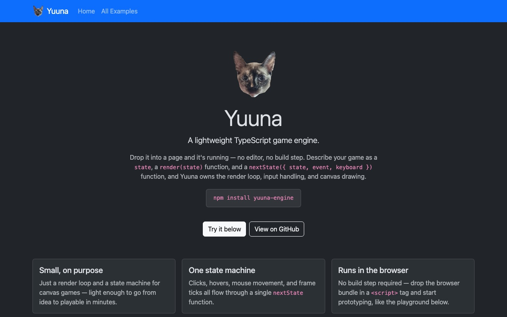
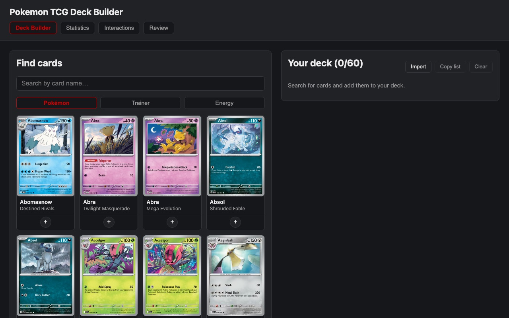
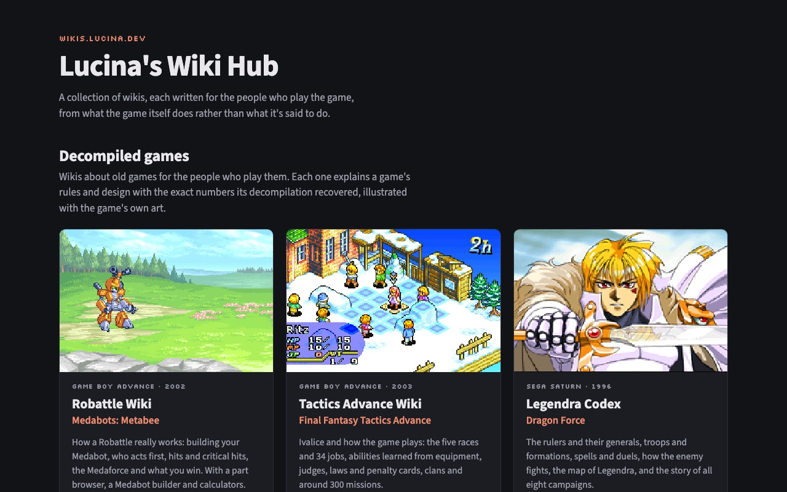
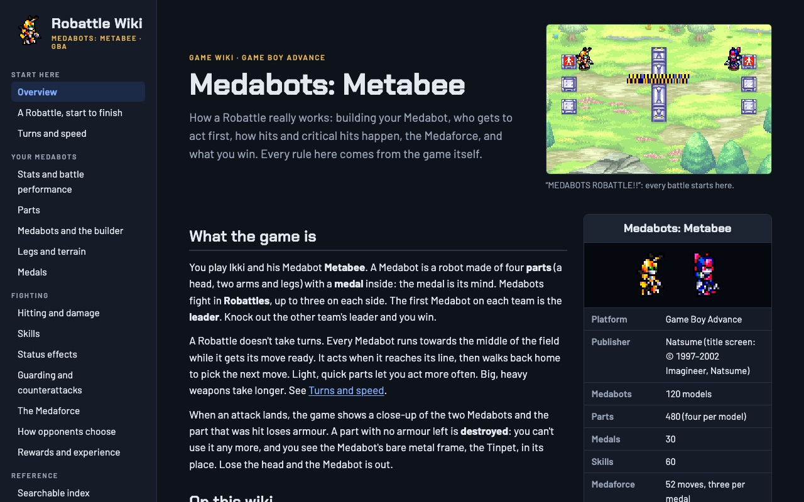
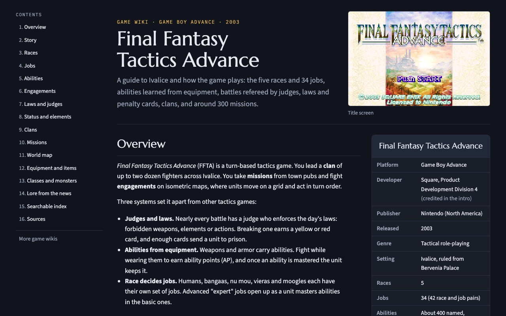
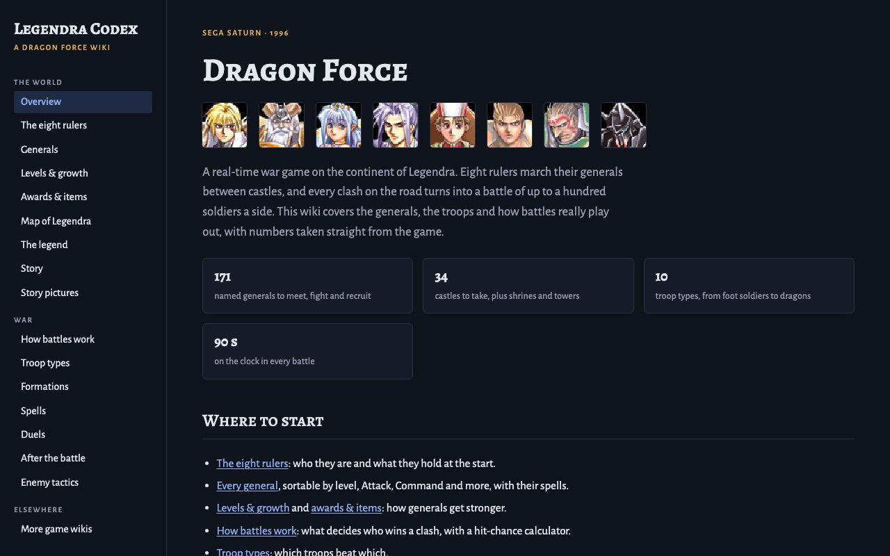
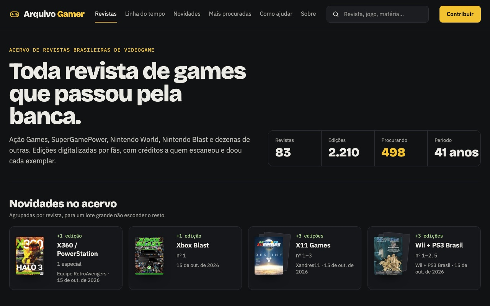
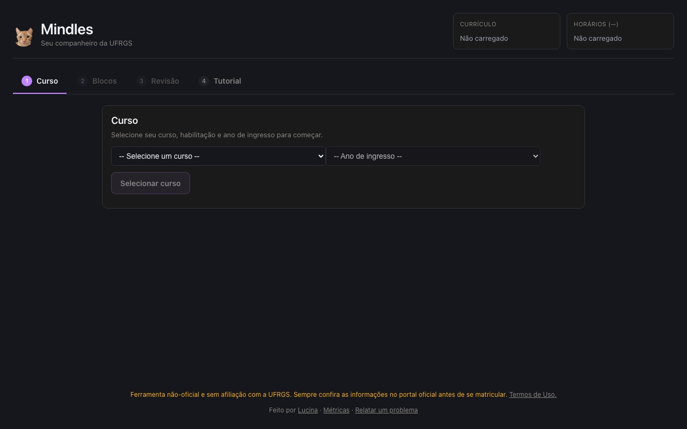
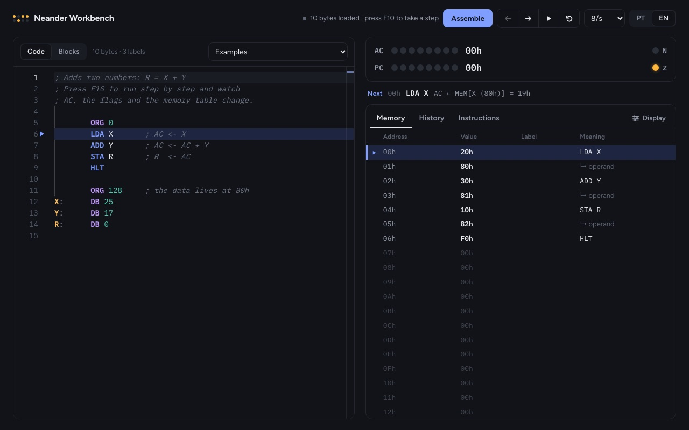
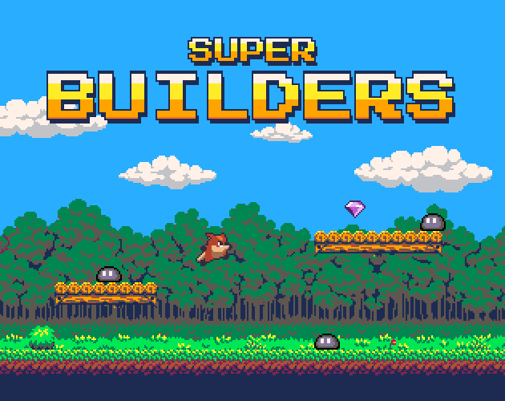

<h1 align="center">Hi, I'm Lucina 👋</h1>

## 🚀 Featured projects

<table>
  <tr>
    <td align="center" width="50%">
      
      <h3><a href="https://lucy-dot-exe.github.io/yuuna/">Yuuna Engine</a></h3>
      
Lightweight state-machine-based game engine for quick prototypes

      TypeScript · <a href="https://github.com/lucy-dot-exe/yuuna">code</a>
    </td>
    <td align="center" width="50%">
      
      <h3><a href="https://lucy-dot-exe.github.io/pokemon-tcg-deck-builder/">Deck Builder for Pokémon TCG</a></h3>
      
A WebApp Pokémon TCG deck builder

      TypeScript · <a href="https://github.com/lucy-dot-exe/pokemon-tcg-deck-builder">code</a>
    </td>
  </tr>
  <tr>
    <td align="center" width="50%">
      
      <h3><a href="https://wikis.lucina.dev/">Lucina's Wiki Hub</a></h3>
      
Wikis about old games for the people who play them, with the exact rules and numbers each game's decompilation recovered

      

        
        
        
      

      <a href="https://medabots.lucina.dev/">Robattle Wiki</a> (Medabots) · <a href="https://ffta.lucina.dev/">Tactics Advance Wiki</a> (FFTA) · <a href="https://dragonforce.lucina.dev/">Legendra Codex</a> (Dragon Force)
    </td>
    <td align="center" width="50%">
      
      <h3><a href="https://arquivo.lucina.dev/">Arquivo Gamer</a></h3>
      
An archive of Brazilian video game magazines, scanned and readable page by page, with credits for whoever scanned, lent or donated each copy

      TypeScript · Next.js
    </td>
  </tr>
</table>

| Project | Description | Stack |
|---|---|---|
| [Twitter Plays Pokemon](https://github.com/lucy-dot-exe/twitter-plays-pokemon) | Twitter-chat-controlled Pokémon, à la Twitch Plays | TypeScript |
| [RestGBA](https://github.com/lucy-dot-exe/RestGBA) | REST API for a GBA emulator | TypeScript |
| [Almond](https://github.com/lucy-dot-exe/almond) | Lightweight alternative to Hazel | TypeScript |

---

## 🎓 Academic projects

<table>
  <tr>
    <td align="center" width="50%">
      
      <h3><a href="https://mindles.lucina.dev">Mindles</a></h3>
      
Companion app for UFRGS students

      TypeScript
    </td>
    <td align="center" width="50%">
      
      <h3><a href="https://lucy-dot-exe.github.io/neander/">Neander</a></h3>
      
A web workbench for <b>Neander</b>, the 8-bit teaching computer designed by Raul Weber and used in the computer architecture courses at UFRGS

      TypeScript · <a href="https://github.com/lucy-dot-exe/neander">code</a>
    </td>
  </tr>
</table>

| Project | Description | Stack |
|---|---|---|
| [Compiladores](https://github.com/lucy-dot-exe/compiladores) | UFRGS Compilers coursework | Rust |
| [Alpha-beta Othello AI](https://github.com/lucy-dot-exe/othello-alpha-beta) | an Alpha-beta Othello AI | Python |
| [Othello AI Server](https://github.com/lucy-dot-exe/othello-ai-server) | Othello/Reversi AI server ([live demo](https://othello-ai-server.vercel.app)) | TypeScript |

Other academic repos

- [Photo Editor](https://github.com/lucy-dot-exe/photo-editor) — Browser-based photo editing app (TypeScript)
- [Reapers Reach](https://github.com/lucy-dot-exe/reapers-reach) — Game project (C++)
- [cppsync](https://github.com/lucy-dot-exe/cppsync) — Sync utility (C++)
- [dfa-minimizer](https://github.com/lucy-dot-exe/dfa-minimizer) — DFA minimization tool (TypeScript)

---

## 🎮 Games published

<table>
  <tr>
    <td align="center" width="50%">
      
      <h3><a href="https://lucinaexe.itch.io/yuunas-td">Yuuna's Heroes</a></h3>
      
An RPG Tower defense game

      Built with <a href="https://github.com/lucy-dot-exe/yuuna">yuuna</a>
    </td>
    <td align="center" width="50%">
      
      <h3><a href="https://lucinaexe.itch.io/stackfall">Stackfall</a></h3>
      
A falling-block puzzle game

      Built with <a href="https://github.com/lucy-dot-exe/yuuna">yuuna</a>
    </td>
  </tr>
  <tr>
    <td align="center" width="50%">
      
      <h3><a href="https://lucinaexe.itch.io/super-builders">Super Builders</a></h3>
      
Create, share and play your own levels and monsters

    </td>
  </tr>
</table>

---

## 🛠 Tech stack

---

## 📊 GitHub stats

  

---

## 📫 Contact

<!-- Edit me: add your real links -->

<!--  -->
<!--  -->
