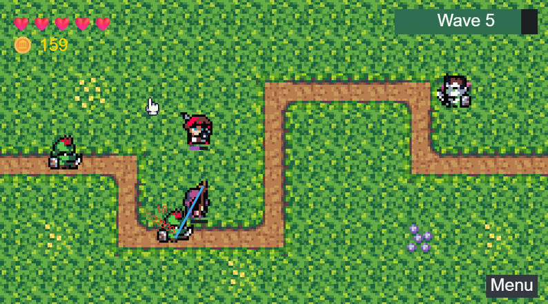
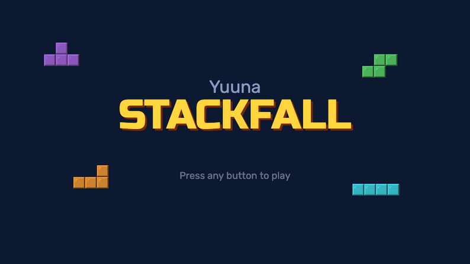

<h1 align="center">Hi, I'm Lucina 👋</h1>

  

- 🔭 Currently building [Yuuna](https://github.com/lucy-dot-exe/yuuna), a lightweight state-machine game engine, plus other small self-contained projects
- 📫 Reach me via GitHub

---

## 🚀 Featured projects

| Project | Description | Stack |
|---|---|---|
| [Yuuna Engine](https://github.com/lucy-dot-exe/yuuna) | Lightweight state-machine-based game engine for quick prototypes ([live demo](https://lucy-dot-exe.github.io/yuuna/)) | TypeScript |
| [Deck Builder for Pokémon TCG](https://github.com/lucy-dot-exe/pokemon-tcg-deck-builder) | A WebApp Pokémon TCG deck builder ([live demo](https://lucy-dot-exe.github.io/pokemon-tcg-deck-builder/)) | TypeScript |
| [Twitter Plays Pokemon](https://github.com/lucy-dot-exe/twitter-plays-pokemon) | Twitter-chat-controlled Pokémon, à la Twitch Plays | TypeScript |
| [RestGBA](https://github.com/lucy-dot-exe/RestGBA) | REST API for a GBA emulator | TypeScript |
| [Almond](https://github.com/lucy-dot-exe/almond) | Lightweight alternative to Hazel | TypeScript |

---

## 🎓 Academic projects

| Project | Description | Stack |
|---|---|---|
| [Mindles](https://mindles.lucina.dev) | Companion app for UFRGS students | TypeScript |
| [Neander](https://github.com/lucy-dot-exe/neander) | A web workbench for **Neander**, the 8-bit teaching computer designed by Raul Weber and used in the computer architecture courses at UFRGS | TypeScript |
| [Compiladores](https://github.com/lucy-dot-exe/compiladores) | UFRGS Compilers coursework | Rust |
| [Alpha-beta Othello AI](https://github.com/lucy-dot-exe/othello-alpha-beta) | an Alpha-beta Othello AI | Python |
| [Othello AI Server](https://github.com/lucy-dot-exe/othello-ai-server) | Othello/Reversi AI server ([live demo](https://othello-ai-server.vercel.app)) | TypeScript |

Other academic repos

- [Photo Editor](https://github.com/lucy-dot-exe/photo-editor) — Browser-based photo editing app (TypeScript)
- [Reapers Reach](https://github.com/lucy-dot-exe/reapers-reach) — Game project (C++)
- [cppsync](https://github.com/lucy-dot-exe/cppsync) — Sync utility (C++)
- [dfa-minimizer](https://github.com/lucy-dot-exe/dfa-minimizer) — DFA minimization tool (TypeScript)

---

## 🎮 Games published

<table>
  <tr>
    <td align="center" width="50%">
      
      <h3><a href="https://lucinaexe.itch.io/yuunas-td">Yuuna's Heroes</a></h3>
      
An RPG Tower defense game

      Built with <a href="https://github.com/lucy-dot-exe/yuuna">yuuna</a>
    </td>
    <td align="center" width="50%">
      
      <h3><a href="https://lucinaexe.itch.io/stackfall">Stackfall</a></h3>
      
A falling-block puzzle game

      Built with <a href="https://github.com/lucy-dot-exe/yuuna">yuuna</a>
    </td>
  </tr>
</table>

---

## 🛠 Tech stack

---

## 📊 GitHub stats

  

---

## 📫 Contact

<!-- Edit me: add your real links -->

<!--  -->
<!--  -->
